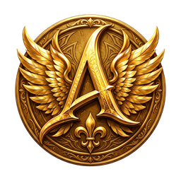

<div align="center">

<a href="https://aureumro.com/">
  
</a>

<br /><br />

[](https://github.com/iOraculo/AureumTools/releases/latest)
[](https://github.com/iOraculo/AureumTools/releases)
[](https://github.com/iOraculo/AureumTools/actions/workflows/ci.yml)
[](#compila%C3%A7%C3%A3o-e-testes)
[](#interface-e-identidade-visual)

<br />

[](https://github.com/iOraculo/AureumTools/releases/latest)
[](https://aureumro.com/)
[](https://aureumro.com/wiki/)
[](https://discord.gg/aureumro)

<br />

**Utilitário oficial tudo-em-um para o servidor [AureumRO](https://aureumro.com/) (Ragnarök Online Pré-Renewal / Gold Times).**  
**Multi-Conta 3 em 1**, **Aureum Hub** (Hora da Votação + Coleção de Cartas + Coleção de Mapas com setas), **Autopot & Yggdrasil unificados**, **Auto-skill** com filtro por classe, **Consumíveis** (Comuns & ROPs), **Anti-debuffs**, **Spammer + Prioridade de Ações**, **Montaria (Rédea)**, **Utilidades (`@refresh` + Auto-Fuga)**, **Macros**, **Temporizadores**, **Mini HUD** e **Guia Interativo** — tudo na identidade visual oficial **Obsidiana & Ouro Real**.

</div>

---

## 📥 Download e Instalação

1. Acesse a página da [**Última Release Oficial**](https://github.com/iOraculo/AureumTools/releases/latest).
2. Baixe o pacote **`AureumTools-vX.Y.Z.zip`** (recomendado) ou o executável avulso **`AureumTools.exe`**.
3. Extraia o arquivo `.zip` em uma pasta de sua preferência.
4. Abra o jogo **AureumRO** e execute **`AureumTools.exe`** como Administrador.
5. O cliente **AureumRO.exe** é detectado e selecionado automaticamente — configure suas teclas e aperte `End` (ou sua tecla escolhida) para ligar!

> **Integridade garantida:** todas as releases incluem o arquivo `SHA256SUMS.txt` gerado automaticamente pelo GitHub Actions. Veja o histórico completo de novidades em [`CHANGELOG.md`](CHANGELOG.md).

---

## ✨ Funcionalidades Completas

### 🖥️ Multi-Conta 3 em 1 (3 Contas em 1 Janela)
- Controle **até 3 contas independentes** (`Conta 1 | Conta 2 | Conta 3`) em **uma única janela** do AureumTools — sem abrir 3 executáveis nem duplicar hooks de teclado.
- Cada aba possui **Cliente (`PID`), Perfil, ON/OFF, Autopot/Yggdrasil, Buffs, Anti-debuffs, Timers, Auto-Fuga e `@refresh` totalmente isolados**, rodando juntos em segundo plano.
- Barra superior com bolinha de status ao vivo (**Verde = ON**, **Laranja = CHAT**, **Cinza = OFF**), nome do personagem detectado e botões rápidos **`Ligar Todas`** / **`Parar Todas`**.

### ⭐ Aureum Hub (Companheiro Exclusivo do AureumRO)
| Módulo | O que faz |
| :--- | :--- |
| **Hora da Votação** | Acompanha os topsites oficiais (**Top Ragnarok BR** e **Top Ragnarok ORG**, 12h cada), permite informar a **hora da última votação (`HH:mm`)** para calcular automaticamente o tempo restante e envia **lembrete sonoro/notificação** na bandeja assim que liberar novo voto. |
| **Coleção de Cartas** | Todas as **28 coleções (140 cartas)** da Wiki separadas por categoria de bônus, com busca instantânea, clique em cada carta para **marcar em tachado (`✓`)**, `Ocultar obtidas`, `Marcar 5` e botão `/navi Colecionador`. |
| **Coleção de Mapas** | Todos os **311 mapas (27 cidades)** agrupáveis **Por Cidade** ou **Por Tipo de Bônus**, exibindo cidade de referência (**`Ref.`**), **setas de direção (`← ↑ ↓ →`, Barco, Trem, andares)** para chegar a pé e painel completo com **todos os itens de drop e porcentagens (`@mc`)**. |

### ❤️ Combate, Sobrevivência & Utilidades
| Recurso | Descrição |
| :--- | :--- |
| **Autopot & Yggdrasil Unificados** | **Poção Branca / Poção Azul** (Autopot comum) e **Yggdrasil** (emergência) visíveis **ao mesmo tempo no mesmo card**, rodando juntos em paralelo com teclas `F1–F24` ativas até durante a Pausa de Chat. |
| **Spammer & Prioridade de Ações** | 3 estados por tecla (`Vazio` = off, `■` = só tecla, `✓` = tecla + clique), modos *Compatibilidade* (com *Sem Shift* e *Mouse Flick*) e *Speed Boost*, hierarquia fixa de **4 níveis** (1º Input do Jogador → 2º Yggdrasil/Panaceia/Auto-Fuga → 3º Consumíveis → 4º Auto-skills) e **Segurar para Pausar (*Hold-to-Pause*)**. |
| **Anti-debuffs** | Focado nos **7 status curáveis** no AureumRO: **Tecla única (Panaceia / Geleia Real)** para Veneno, Silêncio, Cegueira, Maldição, Confusão e Alucinação (ou teclas individuais como Poção Verde / Água Benta) + **Aumentar Agilidade / Guyak / Guaraná** para remover Diminuir Agilidade. |
| **Utilidades (`@refresh` & Auto-Fuga)** | **Anti-Bug Position (`@refresh`)** com atalho de 1 toque (debounce 1,5s) ou intervalo automático, mais **Auto-Fuga de Emergência** (Asa de Mosca, Asa de Borboleta ou skill Teleporte com opção *Confirmar com Enter*) disparado quando o HP cai abaixo da % crítica. |
| **Montaria (Rédea)** | Desce automaticamente da montaria (`EFST_ALL_RIDING`) ao usar habilidades manuais ou automatizadas, com suporte a até 6 teclas extras, opção *Pausar Auto-skill montado* e *Remontar após inatividade*. |
| **Proteções Inteligentes** | **`Pausar em cidades`** (marcado por padrão — pausa tudo em cidades; desmarque para liberar), **Pausa de Chat** (`Enter`/`Esc`), **Foco**, **Pausar ao sentar (`EFST_SIT`)** e desligamento automático se o cliente fechar. |

### 🛡️ Auto-skill & Consumíveis Inteligentes
- **Auto-skill com Filtro por Classe:** seletor **`Classe:`** (`Todas as Classes` + cada classe Pré-Renewal), busca bilíngue instantânea (PT-BR / EN-US sem acentos), **Modo Pré-Renewal**, **SP Mín%**, **Recarga (`CD ms`)** e **Auto-clique em si** para buffs de alvo (Bênção, Agilidade, Assumptio, Kyrie Eleison, Sufrágio, Impositio Manus, Aspersio, **Proteção Química Total**, **Kaahi / Kaupe / Kaite / Kaizel**).
- **Skills Pré-Renewal completas:** inclui **Furtividade (`Cloaking`)**, **Túnel de Fuga (`Chase Walk`)**, **Esconderijo**, **Corpo Fechado (`Steel Body`)**, **Revelação (`Ruwach`)**, **Chama Reveladora (`Sight`)**, **Basílica**, **Canto de Batalha**, **Proteção Química Total**, **Soul Linker (`Kaahi`, `Kaupe`, `Kaite`, `Kaizel`)** e **pré-skill automática do Ninja** (`Aura Ninja` → `Imagem Falsa`).
- **Consumíveis (Comuns vs. ROPs):** organizados em blocos de **Itens Comuns** e **Itens de ROPs** com filtro rápido no topo e 100% dos sprites fiéis aos ícones originais do jogo.

### 🎹 Macros, Temporizadores & Perfis
- **Macros em 1 Aba:** **Macro Troca** (até 5 cadeias de até 7 peças com delay/clique/loop), **Macro Músicas** (Bardo/Odalisca com troca automática Adaga ↔ Instrumento) e **Macro ATK × DEF** (segure a tecla da skill para vestir ATK + spammar e solte para voltar para DEF).
- **Temporizadores:** até 6 timers independentes em segundos (começando limpo com 1 timer expansível).
- **Perfis, Backup `.zip` & Diagnóstico:** criar, renomear, copiar, importar/exportar `.json`, **Backup/Restauração completa `.zip`**, **Troca Automática por Personagem**, **Verificar Conflitos de Tecla** e **Inspetor de Status EFST ao vivo**.
- **Guia / Ajuda Interativo + Pop-ups:** 12 cards visuais pesquisáveis explicando cada recurso, além de pop-ups explicativos ao passar o mouse sobre qualquer botão ou campo do app.

---

## 🎨 Interface e Identidade Visual

O **AureumTools** combina o visual limpo de cards arredondados e pílulas suaves com a tipografia oficial **Google Sans** embutida no executável e a paleta clássica **Obsidiana & Ouro Real** do [**aureumro.com**](https://aureumro.com/) — além de **layout ampliado**, **botão Sol/Lua** no topo, seletor de idioma **`PT-BR` / `EN`** ao lado da versão, **Mini HUD flutuante**, barras vitais arredondadas de **HP/SP em tempo real** e ícones originais sem fundo branco.

| Tema | Paleta Principal | Destaque |
| :--- | :--- | :--- |
| **Obsidiana & Ouro Real** *(Padrão / Escuro)* | `#0B0701` • `#120C03` • `#1E1506` | `#F4D97A` • `#594214` • `#F3EAD0` |
| **Pergaminho & Ouro Antigo** *(Claro)* | `#F2E8CC` • `#FAF4E0` • `#FDF8E8` | `#A08123` • `#D4C098` • `#2A1E0E` |

### 📸 Prévias da Interface (`v2.39.2`)
| Painel Principal & Autopot/Ygg Unificados | Auto-skill com Filtro por Classe | Novo Guia Visual Interativo |
| :---: | :---: | :---: |
|  |  |  |

---

## 🛠️ Compilação e Testes

O projeto utiliza **.NET Framework 4.7.2 (WinForms)** e pode ser compilado no Windows com Visual Studio 2022 ou MSBuild:

```powershell
# Restaurar pacotes NuGet e dependências de testes
nuget restore 4RTools.csproj -PackagesDirectory packages
dotnet restore tests/4RTools.Tests/4RTools.Tests.csproj

# Compilar em modo Release
msbuild 4RTools.sln /p:Configuration=Release /p:Platform="Any CPU"
```

### Executar Testes Unitários
```powershell
dotnet test tests/4RTools.Tests/4RTools.Tests.csproj -c Release
```

---

<div align="center">

<a href="https://aureumro.com/">
  
</a>

<br />

**AureumTools** — Utilitário Oficial para **AureumRO**  
[Site Oficial](https://aureumro.com/) • [Wiki](https://aureumro.com/wiki/) • [Discord](https://discord.gg/aureumro) • [Releases](https://github.com/iOraculo/AureumTools/releases) • [Changelog](CHANGELOG.md)

</div>
