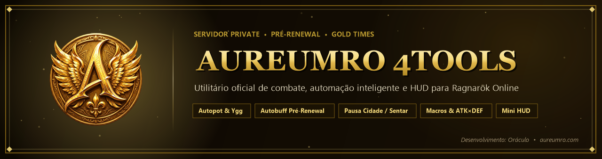

<div align="center">

<a href="https://aureumro.com/">
  
</a>

<br /><br />

[](https://github.com/iOraculo/AureumRO-4Tools/releases/latest)
[](https://github.com/iOraculo/AureumRO-4Tools/releases)
[](https://github.com/iOraculo/AureumRO-4Tools/actions/workflows/ci.yml)
[](#compila%C3%A7%C3%A3o-e-testes)
[](#interface-e-identidade-visual)

<br />

[](https://github.com/iOraculo/AureumRO-4Tools/releases/latest)
[](https://aureumro.com/)
[](https://aureumro.com/wiki/)
[](https://discord.gg/aureumro)

<br />

**Ferramenta oficial de utilitários para o servidor [AureumRO](https://aureumro.com/) (Ragnarök Online Pré-Renewal / Gold Times).**  
Autopot, Autobuff inteligente com Modo Pré-Renewal, pausa automática na cidade e ao sentar, Spam de Skills, Timers, Macros, ATK × DEF e Mini HUD flutuante — tudo na identidade visual oficial **Obsidiana & Ouro Real**.

</div>

---

## 📥 Download e Instalação

1. Acesse a página da [**Última Release Oficial**](https://github.com/iOraculo/AureumRO-4Tools/releases/latest).
2. Baixe o pacote **`AureumRO-4Tools-vX.Y.Z.zip`** (recomendado) ou o executável avulso **`AureumRO.4Tools.exe`**.
3. Extraia o arquivo `.zip` em uma pasta de sua preferência.
4. Abra o jogo **AureumRO** e execute **`AureumRO 4Tools.exe`** como Administrador.
5. Selecione o cliente **AureumRO** no topo da janela (já pré-configurado de fábrica) e configure suas teclas!

> **Integridade garantida:** todas as versões publicadas incluem o arquivo `SHA256SUMS.txt` gerado automaticamente pelo GitHub Actions. Consulte o histórico completo de novidades em [`CHANGELOG.md`](CHANGELOG.md).

---

## ✨ Funcionalidades Principais

### ⚔️ Combate e Sobrevivência
| Recurso | Descrição |
| :--- | :--- |
| **Autopot Normal & Yggdrasil** | Recuperação automática de HP e SP em tempo real com alternância rápida por abas segmentadas. Teclas `F1–F24` continuam protegendo seu personagem mesmo durante a **Pausa de Chat**. |
| **Recuperação de Status / Debuffs** | Limpeza automática de status negativos (Silêncio, Maldição, Veneno, Congelamento, Atordoamento, Sangramento, etc.), suporte a cooldown de **Doce de Elvira** e **Auto Stand**. |
| **Usar buffs na cidade?** | Desativado por padrão: pausa automaticamente Autopot (HP/SP e Yggdrasil), Autobuffs, Recuperação de Status e Skill Timers dentro de cidades/mapas seguros. |
| **Pausa de Chat & Janela em Foco** | Aperte `Enter` no jogo para digitar sem disparar macros (`Esc` ou `Enter` retoma automaticamente), além da opção de pausar quando a janela do jogo não estiver em foco. |
| **Detecção Automática de Desconexão** | Desliga com segurança as automações caso o cliente do Ragnarök seja fechado. |

### 🛡️ Autobuff Inteligente (Skills & Itens)
- **Modo Pré-Renewal (ocultar 3rd/4th):** ativado por padrão na aba *Autobuff - Skills*, exibindo apenas as skills autênticas de Pré-Renewal / Transclasses / Expandidas (incluindo **Canto de Batalha / Battle Chant**, `EFST_GOSPEL`) e ocultando classes 3ª/4ª e exclusivas do Renewal sem apagar atalhos salvos.
- **Pausar ao sentar (`EFST_SIT`):** ativado por padrão por perfil tanto em *Skills* quanto em *Itens*, evitando gastar conversores elementais, comidas e buffs caros enquanto recupera SP sentado fora da cidade.
- **Proteções de Combate:** limite mínimo de **SP%**, tempo de recarga configurável por buff (`CD ms`) para evitar uso duplo e pausa automática sob debuffs incapacitantes.
- **Busca Bilíngue Instantânea:** pesquise qualquer skill, consumível ou debuff em **Português (bRO)** ou **Inglês**, sem precisar de acentos (ex.: `canto`, `gospel`, `pocao`, `furia`, `berserk`).

### 🎹 Automação, Macros e Timers
- **AHK Skill Spammer:** modos de *Compatibilidade* e *Speed Boost*, suporte a clique do mouse e botão para limpar todas as teclas.
- **Skill Timers (Auto Refresh):** 6 slots independentes com temporizador customizável.
- **Macro de Músicas (Song Macro):** múltiplas faixas com reset individual por linha.
- **Macro Switch / Macro Chain:** encadeamento de trocas e habilidades com suporte a clique e modo *Loop* por faixa.
- **Modo ATK × DEF:** troca instantânea de conjunto ofensivo e defensivo em um único atalho.

### 👤 Perfis e Cliente AureumRO
- **Exclusivo para AureumRO:** pré-configurado unicamente para o servidor **AureumRO**, com detecção e seleção automática da janela do jogo ao abrir (suportando também múltiplas janelas no seletor do topo).
- **Gerenciador Completo de Perfis:** criar, renomear, copiar, excluir, importar/exportar `.json` e **Backup/Restauração completa em `.zip`**.
- **Troca Automática por Personagem:** vincule perfis ao nome do personagem detectado em tempo real.
- **Inspetor de Conflito de Teclas:** identifica atalhos duplicados entre abas antes de ir para WoE/MVP.

---

## 🎨 Interface e Identidade Visual

O **AureumRO 4Tools** segue fielmente a estética oficial de [**aureumro.com**](https://aureumro.com/), com barra lateral agrupada, ícones vetoriais limpos, barras vitais de **HP/SP em tempo real**, **Mini HUD flutuante**, ícones transparentes sem fundo branco e troca ao vivo entre **Português (PT-BR)** e **Inglês (EN-US)**.

| Tema | Paleta Principal | Destaque |
| :--- | :--- | :--- |
| **Obsidiana & Ouro Real** *(Padrão / Escuro)* | `#0B0701` • `#120C03` • `#1B1304` | `#F4D97A` • `#ECC861` • `#A67E1A` |
| **Pergaminho & Ouro Antigo** *(Claro)* | `#F2E8CC` • `#FAF4E0` • `#FDF8E8` | `#D4C098` • `#A08123` • `#2A1E0E` |

---

## 🛠️ Compilação e Testes

O projeto utiliza **.NET Framework 4.7.2 (WinForms)** e pode ser compilado no Windows com Visual Studio 2022 ou MSBuild:

```powershell
# Restaurar pacotes NuGet e dependências de testes
nuget restore 4RTools.csproj -PackagesDirectory packages
dotnet restore tests/4RTools.Tests/4RTools.Tests.csproj

# Compilar em modo Release
msbuild 4RTools.sln /p:Configuration=Release /p:Platform="Any CPU"
```

### Executar Testes Unitários
```powershell
dotnet test tests/4RTools.Tests/4RTools.Tests.csproj -c Release
```

---

<div align="center">

<a href="https://aureumro.com/">
  
</a>

<br />

**AureumRO 4Tools** — Desenvolvimento: **Oráculo**  
[Site Oficial](https://aureumro.com/) • [Wiki](https://aureumro.com/wiki/) • [Discord](https://discord.gg/aureumro) • [Releases](https://github.com/iOraculo/AureumRO-4Tools/releases) • [Changelog](CHANGELOG.md)

</div>
